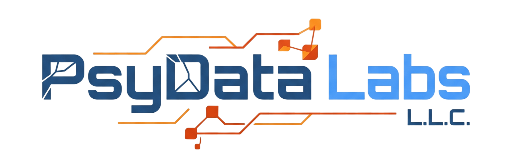

# PsyData Labs L.L.C. 

[pdl]: https://psydata.net
[gh]: https://github.com/psydatalabsllc
[gl]: https://gitlab.com/psydatalabsllc
[discord]: https://discord.gg/DzKmYWrNpD

[PsyData Labs L.L.C.][pdl][^1] is an independent applied systems company and hybrid intelligence lab. To preserve our architectural sovereignty, zero-trust security standards, and strict privacy guarantees, our foundational engineering is funded through direct community backing, commercial pre-purchases, and enterprise syndicates via our **[Early Access Program (EAP)][eap]**.

## Where Your Backing Goes

Every dollar contributed directly accelerates our core operational runway across five primary areas:

1. **Bare-Metal & Multi-Node Infrastructure:** Provisioning, bandwidth, and hardening of our compute shards (`QUANTA`, `SHARD-A`, `SHARD-B`), edge relays, and private CI/CD runners.
2. **Zero-Trust & Cryptographic R&D:** Engineering **SYNSECTRIX** (unified identity & PKI), **SATP** (Secure Access Transfer Protocol), **Directive One Vault**, **DANK Nexus**, and **TELISPECT**.
3. **Compliance & Third-Party Security Audits:** Funding formal penetration testing and certification readiness across **SOC 2 Type II**, **ISO/IEC 27001**, **ISO/IEC 42001**, **GDPR & UK GDPR**, **HIPAA Safeguards**, and **NIST AI RMF**.
4. **Open-Source Ecosystems & SDKs:** Publishing and maintaining high-assurance Rust crates, Go microservices, TypeScript SDKs, Python pipelines, and C/C++/C# bindings.
5. **Cryptographic Hardware & Fulfillment:** Provisioning custom laser-etched **FIDO2 / WebAuthn Hardware Security Keys** and digital wallet passes for our founding cohorts.

---

## Funding Pathways Overview

Full tier breakdowns, wave admittance rules (`Wave 0` through `Wave 4`), and cumulative tenure milestones are detailed in **[EARLY-ACCESS-PROGRAM.md][eap]**.

| Pathway | Contribution Range | Platform Credit Match | Primary Highlights & Deliverables |
| :--- | :--- | :--- | :--- |
| **Track 0 — Free & Merit** | **$0** | — | • Free Main & Insider Waitlists at [wait.psydata.net][wait] • Open-Source Contributor Track (2+ merged PRs = Wave 2) • Security Researcher Fast-Track (valid disclosure = Wave 1) |
| **Track 1A — Individual One-Time** | **$1 – $2,500+** | **Up to 230% Match** *(up to $5,750 credit)* | • Wave 4 to Wave 0 (Genesis) sandbox & native build access • Personal discounts (**5% to 75% off**) & lifetime account overrides • Apple/Google Wallet passes, apparel kits & FIDO2 hardware keys |
| **Track 1B — Individual Recurring** | **$2/mo – $150/mo** *($20/yr – $1,500/yr)* | **50% to 183% Rollover** *(up to $275/mo credit)* | • Continuous Wave 3 to Wave 0 access & private SDK registries • Cumulative Tenure Milestones (permanent unlocks at Months 6, 10, 12, 24) • Quarterly & semi-annual shareable friend promo codes |
| **Track 2A — Enterprise One-Time** | **$500 – $25,000+** | **130% to 375% Match** *(up to $93,750+ credit)* | • 3 to Unlimited team seats with Wave 1 / Wave 0 Genesis access • Multi-year Corporate MSA rate locks (**15% to 45% off**) • Custom OIDC/SAML/SATP adapters, dedicated shards & up to 50x FIDO2 keys |
| **Track 2B — Enterprise Recurring** | **$100/mo – $5,000/mo** *($1k/yr – $50k/yr)* | **135% to 300% Rollover** *(up to $15,000/mo credit)* | • Predictable OpEx syndicate retainers across 5 to Unlimited seats • Direct Slack/Discord engineering bridges & advisory board seats • Formal Commercial Invoices, W-9s & Pre-Purchase Service Agreements |
| **Track 3 — Sponsored Directives** | **$250 – $10,000+** | **Full Tier Match Applies** | • Earmark funds for specific **Node/Cluster Sponsorships**, **Protocol/SDK Bounties**, or **Compliance & Audit Acceleration** |

---

## How to Contribute or Pre-Purchase

* **Explore the Full Early Access Program:** Read the complete specification in **[docs/EARLY-ACCESS-PROGRAM.md][eap]**.
* **Individual & Developer Backing:** Use our GitHub Sponsors portal or direct EAP checkout links on [psydata.net][pdl].
* **Enterprise Procurement, Invoices & W-9s:** Contact our Early Access & Billing Teams to initiate a commercial pre-purchase, syndicate retainer, or custom invoice:
  * **Early Access Team:** [early@psydata.org](mailto:early@psydata.org)
  * **Billing & Procurement:** [billing@psydata.org](mailto:billing@psydata.org)
* **Join the Free Waitlist:** Not ready to contribute financially? Register for `$0` at **[wait.psydata.net][wait]**.

---

## Commercial & Tax Disclosures

* **Non-Charitable Commercial Backing:** PsyData Labs L.L.C. is a for-profit limited liability company registered in the United States. Contributions and EAP backing payments are commercial pre-launch contributions and platform credit pre-purchases—**not** charitable donations under IRC § 501(c)(3)—and are not tax-deductible as charitable contributions. Corporate backers should consult their tax advisors regarding standard software, cloud infrastructure, or R&D expense treatment.
* **No Equity or Ownership:** Funding contributions do not grant equity, shares, voting rights, profit-sharing, or ownership in PsyData Labs L.L.C.

---

[^1]: PsyData Labs L.L.C. is an emerging applied systems company and hybrid intelligence lab. We are engineering zero-trust software ecosystems, infrastructure, identity, and providing AI governance and secure data services. PsyData Labs L.L.C. is also referred to as "PsyData Labs", "PsyData", "PDL", our as "us", "our", or the "Company". We encourage you to visit our [website][pdl], [GitHub][gh], and [GitLab][gl].

Read about our [Five Domains](./docs/FIVE-DOMAINS.md) - Read about our [Early Access Program](./docs/EARLY-ACCESS-PROGRAM.md)  

<small>
Copyright © 2026 PsyData Labs L.L.C.
All Rights Reserved (PDL-LIC-001)
Website: https://psydata.net/
</small>

See our [License](./LICENSE.md)

<!-- 

Website: https://psydata.net
GitHub: https://github.com/psydatalabsllc
GitLab: https://gitlab.com/psydatalabsllc

Discord Invite (raw): https://discord.gg/DzKmYWrNpD
Discord Invite (PDL): https://discord.psydata.net/

PsyData Labs L.L.C. is an emerging applied systems company and hybrid intelligence lab. We are engineering zero-trust software ecosystems, infrastructure, identity, and providing AI governance and secure data services. PsyData Labs L.L.C. is also referred to as "PsyData Labs", "PsyData", "PDL", our as "us", "our", or the "Company". We encourage you to visit our [website][pdl], [GitHub][gh], and [GitLab][gl].

Copyright © 2026 PsyData Labs L.L.C.
All Rights Reserved (PDL-LIC-001)
Website: https://psydata.net

-->